# UI redesign: Duolingo-style, dark mode

Design reference for the "UI redesign" item in [ROADMAP.md](../../ROADMAP.md). Turn it into a
feature with `/speckit-specify` when it is picked up; this file is the input, not the spec.

**Mockups**: Design canvas "Duopona – mobile UI" (private to the owner):
https://claude.ai/code/artifact/fcde3f82-1044-42db-9fb0-e14a7d80a737
Seven 390×844 phone screens, linked for click-through (Play mode).
**Images** (2×, exported from the canvas): [`mockups/`](mockups/); the source of truth for implementation.

## Screens

Mockups now show the purple theme ([purple-theme.md](purple-theme.md)) and, on 03–07, the
mascot instead of the prompt icon and star badge ([mascot.md](mascot.md)); both are implemented
(features 011 and 012).

| # | Mockup | Current code | Main changes |
|---|--------|--------------|--------------|
| 1 | [Lesson path](mockups/01-lesson-path.png) | `HomeRoute`, `LessonList` | Card list → vertical zigzag path of round nodes; course banner; top bar with wordmark and "done / total" counter; credit footer kept |
| 2 | [Lesson intro](mockups/02-lesson-intro.png) | `LessonIntro` | New words as 2-column chips (word + meaning); grammar in a tinted card; full-width Start in a bottom bar; X to go back |
| 3 | [Multiple choice](mockups/03-multiple-choice.png) | `ExerciseScreen`, `MultipleChoice` | Top bar: X (quit), progress bar, "n/total"; prompt in a bubble next to an icon; options as numbered cards; Check in a bottom bar |
| 4 | [Wrong answer](mockups/04-wrong-answer.png) | `FeedbackBanner` | Bottom sheet replaces the action bar: red tint, "Not quite", correct answer, red Continue; options disabled, the chosen one red |
| 4a | [Wrong + explanation hidden](mockups/04a-wrong-explanation-hidden.png) | `FeedbackBanner` (`ExplanationBlock`) | Mistake explanation (feature 008) collapsed by default; a "Why?" toggle (chevron down) next to the correct answer |
| 4b | [Wrong + explanation shown](mockups/04b-wrong-explanation-shown.png) | `FeedbackBanner` (`ExplanationBlock`) | Toggle reads "Hide" (chevron up); explanation in a darker card inside the sheet: word meanings, picked-word meaning, grammar title + source lesson + note; sheet grows up to ~60% of the screen, only the explanation scrolls, Continue always visible |
| 5 | [Word bank](mockups/05-word-bank.png) | `WordBank` | Answer on two ruled lines; used tiles leave a grey placeholder in the bank; "Grammar" tag when `practisesGrammar` is true |
| 6 | [Correct answer](mockups/06-correct-answer.png) | `FeedbackBanner` | Green-tinted sheet, "pona! Correct.", Continue |
| 7 | [Lesson complete](mockups/07-lesson-complete.png) | `LessonSummary` | Gold star badge; "Correct X / Y" and "Unlocked <next lesson>" stat cards; Continue + "Replay lesson" |

## Mockups

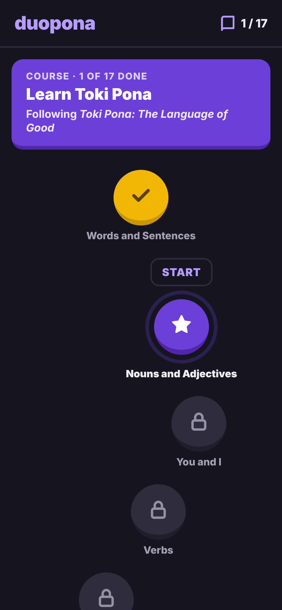
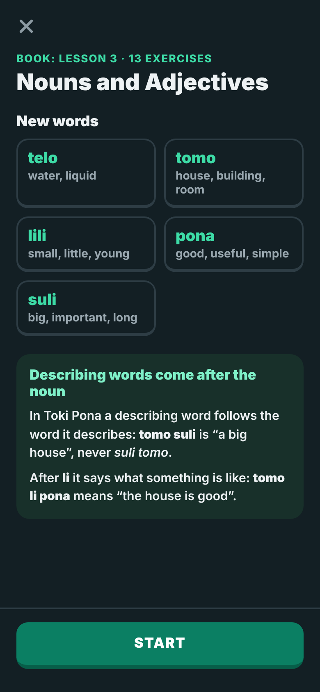
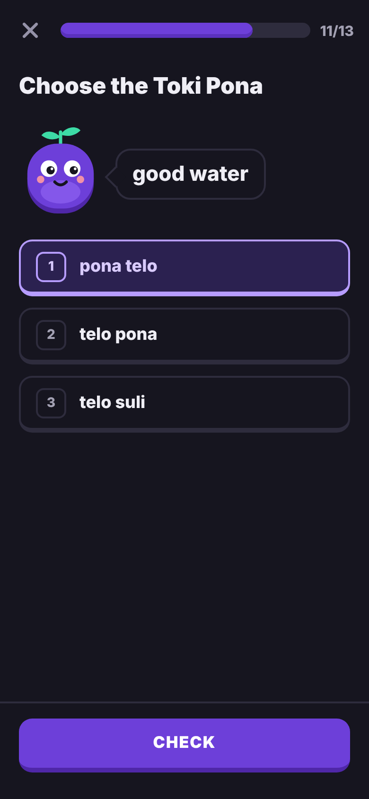
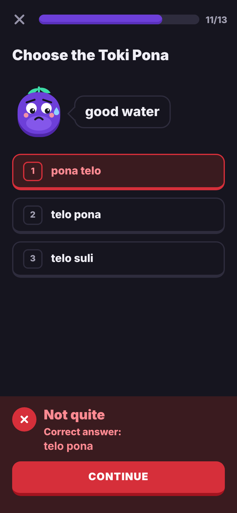
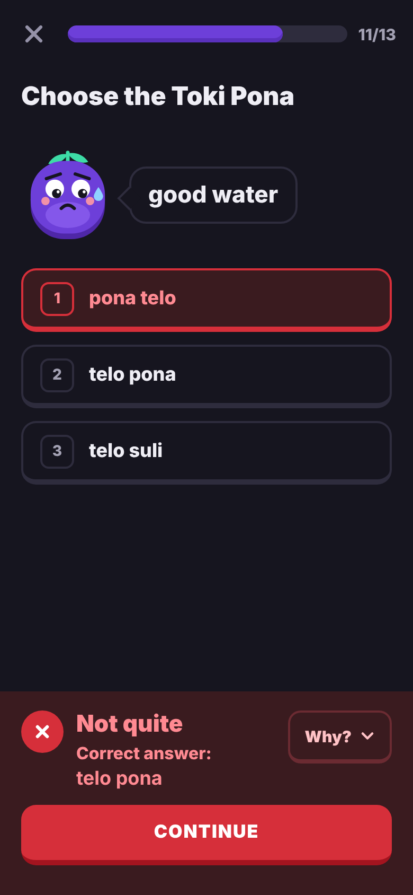
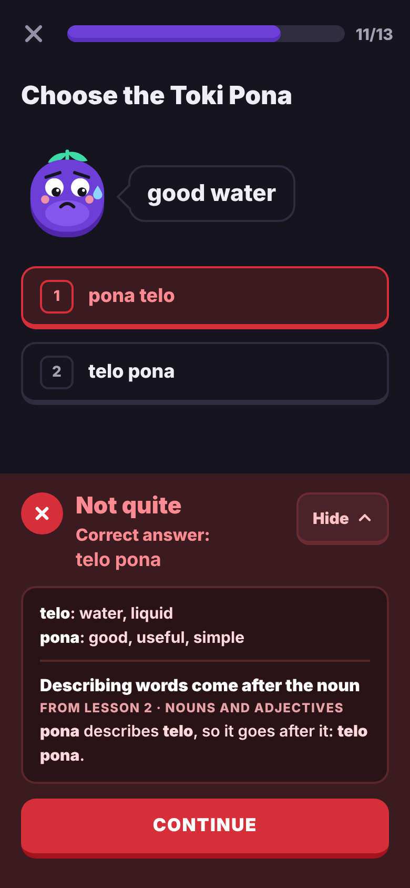
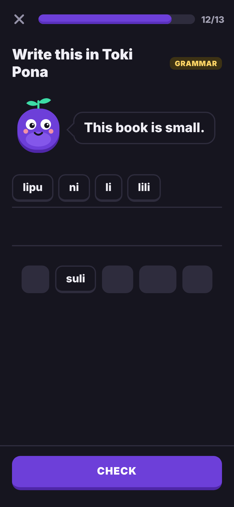
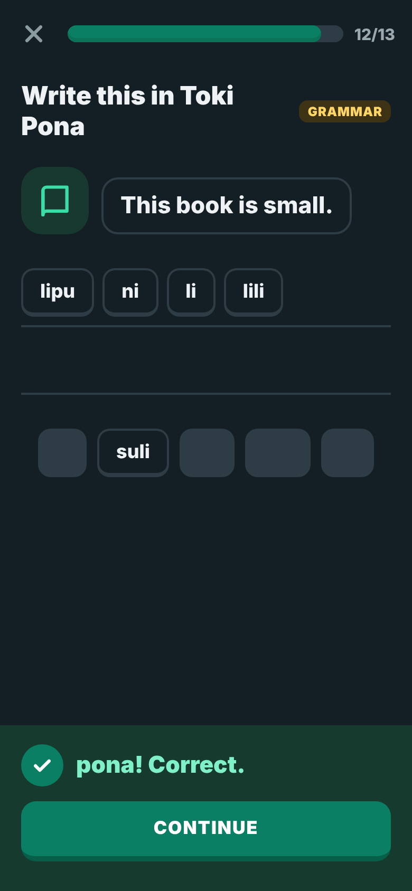
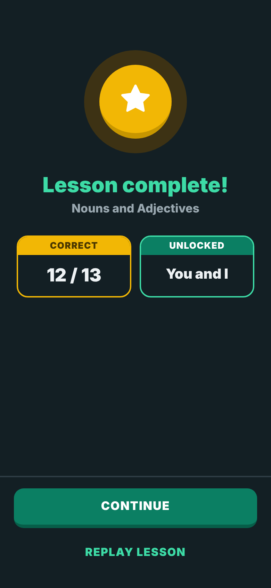
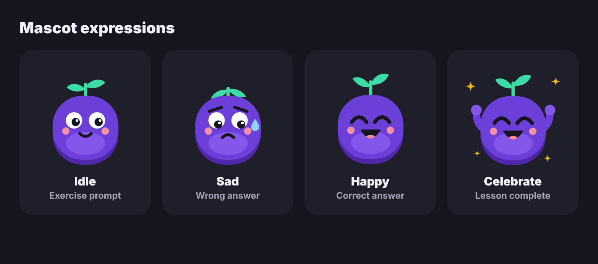
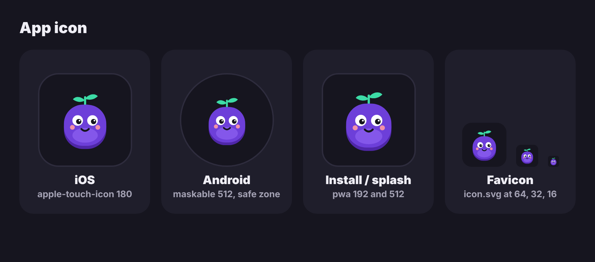

## Tokens (dark theme)

> Superseded by [purple-theme.md](purple-theme.md) (planned): the mockups now show purple.
> The table below is the green palette that feature 004 shipped.

| Token | Value | Use |
|-------|-------|-----|
| `bg` | `#131F24` | Page background, tiles, option cards |
| `text` | `#EEF2F4` | Body text |
| `text-muted` | `#9AA8B0` | Secondary text, counters |
| `line` | `#2E3D45` | Borders, dividers, progress track, locked node, tile placeholder |
| `line-deep` | `#1E2A30` | Bottom "3D" edge of locked nodes |
| `primary` | `#0B7F63` | Filled buttons, current node, progress fill, banner (white text on it) |
| `primary-deep` | `#075E49` | Bottom edge of primary buttons / nodes |
| `primary-text` | `#3DDBA6` | Green text, links and icons on the dark background; selected border |
| `primary-text-strong` | `#7FF0C8` | Headings on tinted green surfaces, link hover |
| `primary-tint` | `#17392F` | Selected option bg, icon tiles, current-node ring |
| `grammar-tint` | `#18302A` | Grammar card on the intro |
| `success-tint` | `#163A2E` | Correct-answer sheet |
| `error` / `error-deep` | `#D62F3A` / `#A3141F` | Wrong: icon, border, Continue button + its edge |
| `error-text` | `#FF8A92` | Text on the wrong-answer sheet |
| `error-tint` | `#3A1B1F` | Wrong-answer sheet, wrong option bg |
| `gold` / `gold-deep` | `#F2B705` / `#C79600` | Completed nodes, summary badge, "Correct" card |
| `gold-ink` | `#5A4300` / `#4A3700` | Check icon / label on gold |
| `gold-tint` | `#3D3214` | Summary badge halo, Grammar tag bg (text `#FFD666`) |
| `icon-muted` | `#8C9AA2` | X (close), lock icon |

## Type and shape

- Font: **Nunito** 600–900. Self-host it (e.g. `@fontsource/nunito` or a woff2 in `public/`) so
  it works offline (Constitution V) and makes no third-party request (Constitution II).
- Sizes: screen title 24–30 px / 900; prompt 22 px / 800; options and tiles 18 px / 800; body 15 px / 600;
  labels 13 px / 800–900 uppercase with letter-spacing.
- "Chunky" style: a darker `border-bottom` (4–7 px) gives buttons, nodes, chips and option cards
  their 3D edge. Radii: buttons/options 14 px, tiles 12 px, cards 16 px, nodes 50 %.
- Primary button: 52 px tall, full width, uppercase 17 px / 900. Path node: 76×70 px. All
  targets ≥ 44 px; bottom bars pad 28 px at the bottom plus the safe-area inset.

## Open points for the spec

- The "1 / 17" counter in the top bar and the course banner are new (data already exists in progress state).
- Dark only, or dark + light following `prefers-color-scheme`? The light palette is in the
  canvas history (first version).
- Keyboard shortcuts 1–3 shown on option cards: decide whether to implement or drop the numbers.
- Do after "PWA & mobile compliance" (Constitution governance: PWA must be the next feature).
- Mistake explanation toggle (4a/4b): a real `<button>` with `aria-expanded` / `aria-controls`;
  collapsed again on every new mistake; focus stays on Continue (`focusOnMount`); the
  explanation text stays out of the `role="status"` announcement until opened. New tokens:
  toggle border `#6B2B32`, pressed bg `#4A2328`, text `#FFC2C6`; explanation card bg `#2A1316`,
  border `#5A262C`, text `#FFD9DB`, source-lesson label `#E7A3A8`.
